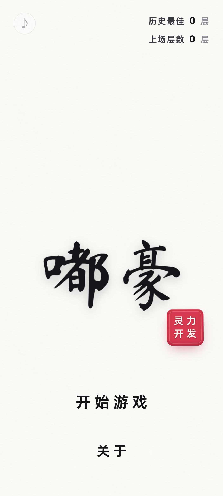
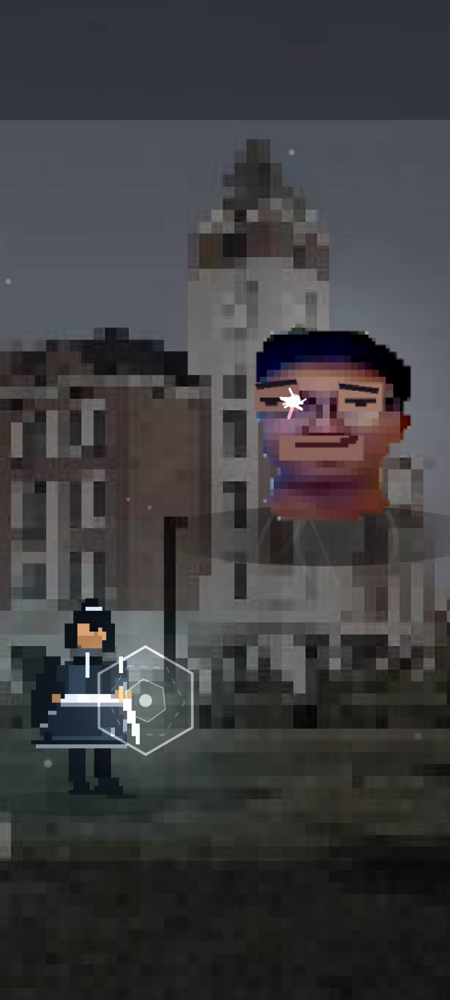

# 嘟豪 · 九十九层

> 你必须杀死那个最了解你的人九十九次，才能知道他其实就是你。

《嘟豪》是一款「魂类武侠 × 平行世界科幻」的像素风动作小游戏。你扮演剑客**嘟豪**，被困在一座九十九层的高塔里；每一层的守关者都是同一个人——话痨 BOSS **肚耗**。每击败他一次，他就会在微微泛黄的白光里复活，笑着变强，也笑着记得你忘记的一切。

九十九层之后，电影画幅拉开。真相只差一剑。

**🎮 在线游玩：<https://lewb521.github.io/duhao/>**





## 特色

- **单文件、离线可玩**：`index.html` 内联了全部图片、音频、字体，双击即开，不依赖服务器。
- **红眼弹反**：BOSS 攻击前双眼会鲜红 0.3 秒（外加 0.1 秒判定窗），点击「弹」用量子护盾反弹激光。
- **灵力激光**：每次反弹造成 15 点伤害并积攒 1 格灵力；满 5 格后点击「靈」，释放持续 2 秒的激光柱，造成 10 倍伤害。
- **99 层循环**：被击中损失 33% 生命；击败 BOSS 触发「地狱归来 / Faze up」，血量 +20%、话更多；死亡后层数清零，但记忆保留。
- **全程对白**：约 40% 剧情 + 50% 嘲讽 + 10% 闲聊。随层数上升，主角的戒备会逐渐变成无所谓和一点嘲讽。
- **一镜到底**：主界面书法「嘟豪」在开局后飞往右上角悬挂，结局时回到屏幕中央变白，再滚动字幕。
- **16:9 电影结局**：99 层后进入黑边电影叙事，镜头、字幕与蓝色利刃。
- **自适应屏幕**：手机竖屏 / 横屏 / 平板分别排版，字幕居中稍下、字号自适应。
- **单色 UI**：游戏内界面白灰单色平涂，不使用渐变；BOSS 红眼与结局蓝刃作为叙事必要的强调色。

## 操作

- 点击「弹」反弹激光；点击「靈」释放大招（满 5 格后亮起）。
- 点击底部字幕可立刻显示整句 / 进入下一句。
- 右上角 ✕ 暂停；键盘 `空格` = 反弹，`F` = 大招，`Esc` = 暂停。

## 仓库结构

```
index.html          # 成品：单文件游戏（GitHub Pages 入口）
src/                # 开发源码（index.html / css / js / data）
assets/             # 美术、音效、字体与授权清单
build.py            # 单文件构建脚本：python3 build.py
docs/               # README 使用的预览图
README.md
```

## 构建

```bash
python3 build.py
```

会读取 `src/`、`assets/` 并生成 `dist/嘟豪.html` 单文件。

## 素材与致谢

- 作者：灵力开发
- 特别出演：duhao
- 音效：[kavex/GameSounds](https://github.com/kavex/GameSounds)（GPL-3.0）、[romainsimon/uisfx](https://github.com/romainsimon/uisfx)（MIT/CC0）、[ohrafaelmartins/sound-effects](https://github.com/ohrafaelmartins/sound-effects)、[eakbulut/foley](https://github.com/eakbulut/foley)（MIT）
- 字体：阿里巴巴普惠体（免费商用，子集内联）
- 原始世界观 / 对话 / 美术素材：用户提供，授权本项目使用

> 注意：kavex/GameSounds 音效为 GPL-3.0，再分发时请遵循对应许可；逐文件来源见 [assets/audio/CREDITS.json](assets/audio/CREDITS.json)。

—— 愿你在塔外，见到雾散。
